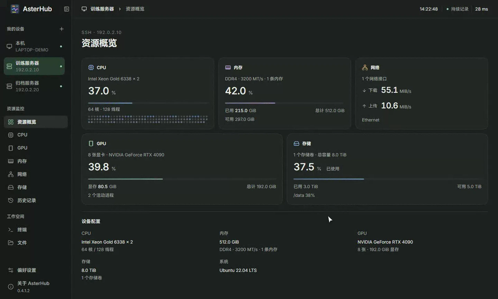
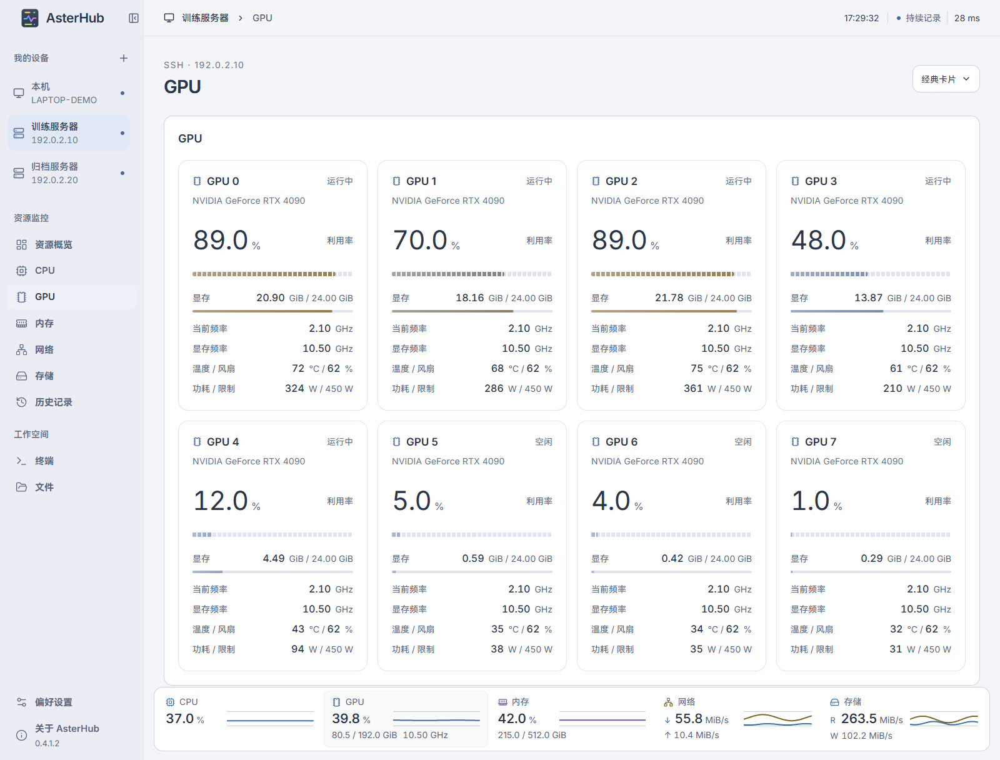
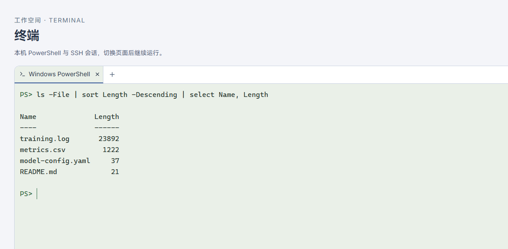
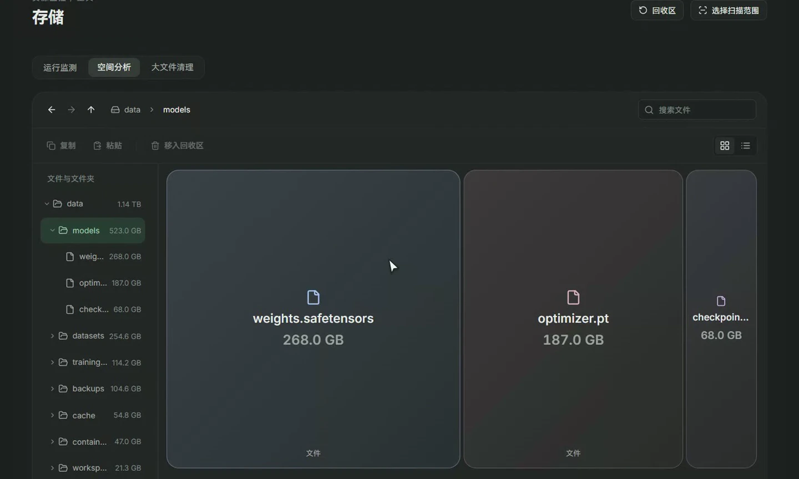

# AsterHub

**连接设备，看见运行。**

AsterHub 是一个桌面工作台。你可以查看本机的运行状态，也可以通过 SSH 连接服务器。发现显存快满了、网络变慢了，或者磁盘空间不够时，可以在同一个窗口查看历史、打开终端或传输文件。

[下载 Windows](https://github.com/1159112519/AsterHub/releases/latest) · [下载 Ubuntu](https://github.com/1159112519/AsterHub/releases/tag/ubuntu-v0.1.3) · [全部版本与更新说明](https://github.com/1159112519/AsterHub/releases) · [反馈问题](https://github.com/1159112519/AsterHub/issues)



*截图来自 Windows 工作台，使用演示设备与示例数据。*

## 能做什么

| 想做的事 | 在哪里看 |
| --- | --- |
| 确认电脑或服务器是否满载 | 在**资源概览**同时查看 CPU、GPU、内存、网络和存储。 |
| 找出哪张显卡忙、哪张还有显存 | 在 **GPU** 页逐卡查看利用率、显存和可读取的温度、功耗。 |
| 查刚才发生了什么 | 在**历史记录**选择时间段，回看已采集的资源数据。 |
| 检查网络与磁盘 | 查看接口收发速率、运行网络测速，或在**空间分析**中逐层查看大目录和文件。 |
| 执行命令或传文件 | 用内置**终端**打开本机 PowerShell 或 SSH 会话，在**文件**页浏览和传输文件。 |

## 下载与安装

| 平台 | 系统要求 | 安装方式 |
| --- | --- | --- |
| Windows | Windows 10 / 11，x64；需要 WebView2 Runtime | 打开 [Windows 发行页](https://github.com/1159112519/AsterHub/releases/latest)，在 **Assets** 中下载 `AsterHub-Setup-*.exe` 并运行。 |
| Ubuntu | Ubuntu 22.04 桌面，amd64 | 下载 [Ubuntu 0.1.3 的 DEB](https://github.com/1159112519/AsterHub/releases/tag/ubuntu-v0.1.3)，再运行下面的命令。 |

```bash
sudo apt install ./AQServer-0.1.3-ubuntu-all.deb
```

Windows 与 Ubuntu 独立发布。Ubuntu 版可查看资源和历史记录；下方的 Windows 界面与功能不代表 Ubuntu 版。各发行页的 **Assets** 提供安装包和 SHA-256 校验文件。`Source code` 压缩包无需下载。

## 第一次使用

1. **看本机。** 打开 AsterHub，在左侧选「本机」，从资源概览开始。
2. **连服务器。** 在「我的设备」旁点 `+`，填写地址、SSH 端口和用户名，选择服务器支持的认证方式，再测试连接。首次连接时，核对服务器的 SSH 主机指纹。
3. **查问题。** 从概览进入资源详情，或打开历史记录对照时间。需要执行命令或传输文件时，从左侧进入相应页面。

远程设备需要能从你的电脑访问，并已启用 SSH。只在内网或 VPN 可达的服务器，请先连上对应网络。可显示的指标取决于设备、系统和访问权限。

## 界面一览

### 多卡 GPU

在同一页对照各卡的利用率和显存用量。



### 内置终端

在查看监控的同一工作台里执行命令。下图用 PowerShell 按大小列出示例目录中的文件。



### 存储空间分析

从目录钻取到文件，按面积看清空间主要被什么占用。



## 更新与反馈

- **找更新：** 每个版本的新功能和修复都列在 [GitHub Releases](https://github.com/1159112519/AsterHub/releases)。Windows 也可以在「关于与更新」中检查更新。
- **提问题：** 可以用软件内的「反馈与建议」，也可以到 [GitHub Issues](https://github.com/1159112519/AsterHub/issues) 留下系统、AsterHub 版本和复现步骤。附截图时请遮住账号、服务器地址、密钥和其他私密信息。

## Star History

<a href="https://www.star-history.com/?repos=1159112519%2FAsterHub&amp;type=date">
  <picture>
    <source media="(prefers-color-scheme: dark)" srcset="https://api.star-history.com/svg?repos=1159112519%2FAsterHub&amp;type=date&amp;theme=dark" />
    
  </picture>
</a>
