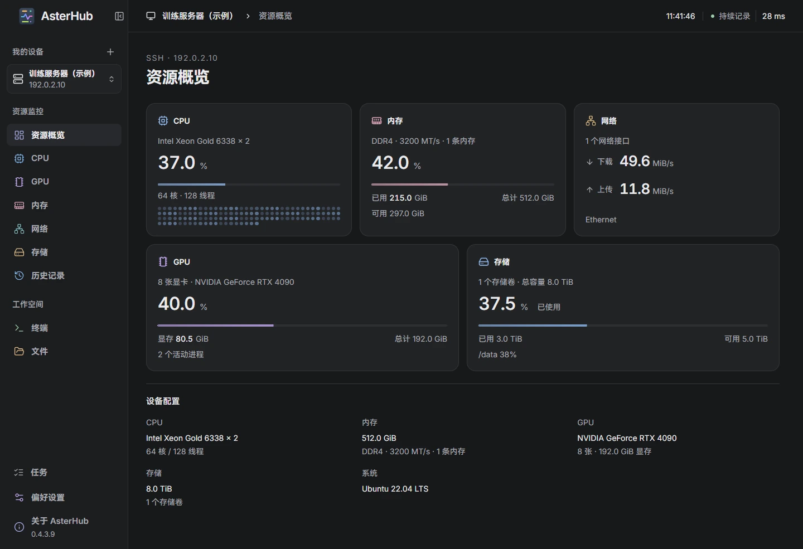
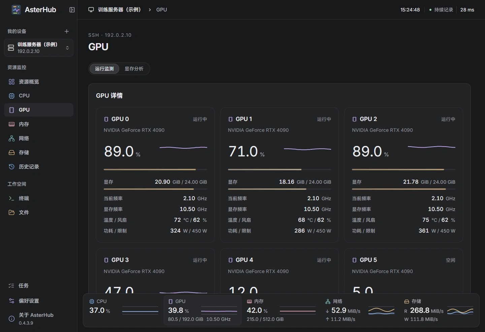

  

<h1 align="center">AsterHub</h1>

<strong>本机与服务器的资源监测工作台</strong>

  看实时负载、回查峰值、对比多张显卡。 
  通过 SSH 打开终端、浏览和传输文件。

  
  
  
  

   
  资源概览 · 演示设备与示例数据

## 主要功能

- **随时看负载。** 任务栏可显示 CPU、GPU、内存和网速，支持自选指标、顺序和颜色。

- **回查性能峰值。** 选一段时间，对照 CPU、GPU、内存曲线和已记录的进程占用。网络页也能分析区间流量或单独测速。

- **比较多张显卡。** 逐卡看利用率和显存，或汇总多卡趋势。

- **找出空间占用。** 扫描磁盘或文件夹，逐层查看目录大小、定位大文件。移入回收区的项目可以恢复。

- **排查远端设备。** 通过 SSH 看服务器运行状态、打开终端、浏览和传输文件。下载、传输和扫描进度集中在任务中心。

<strong>展开多卡 GPU 界面</strong>

   
  多卡监测页面局部 · 示例数据；可见的指标取决于设备、驱动与访问权限。

## 下载安装

1. 打开 [最新发行版](https://github.com/1159112519/AsterHub/releases/latest)，在 **Assets** 下载 `AsterHub-Setup-*.exe` 并运行。
2. 打开 AsterHub 后，选左侧「本机」开始监测；要添加服务器，在「我的设备」旁点 `+`，填写 SSH 连接信息。

**系统要求：** Windows 10 1809 或更新版本（64 位）、.NET Framework 4.7.2 或更新版本。安装器会检查 Microsoft Edge WebView2 Runtime。

**已经安装？** 打开「关于 AsterHub」检查更新，下载完成后点击「安装并重启」。各版本的改进见[更新记录](CHANGELOG.md)。

## 开发与许可

构建方法见[开发指南](docs/BUILDING.md)，第三方组件及其许可见[第三方组件说明](docs/THIRD-PARTY.md)。项目源码公开浏览，尚未授予通用开源许可。
