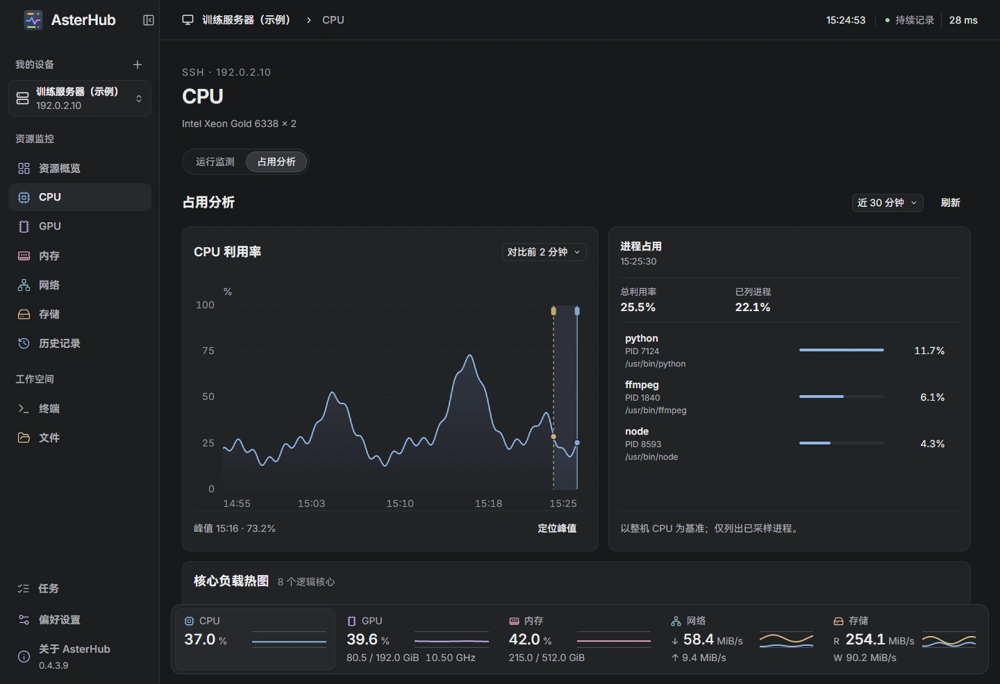
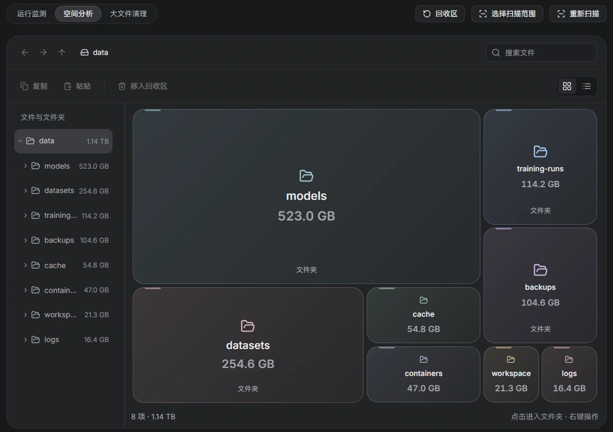
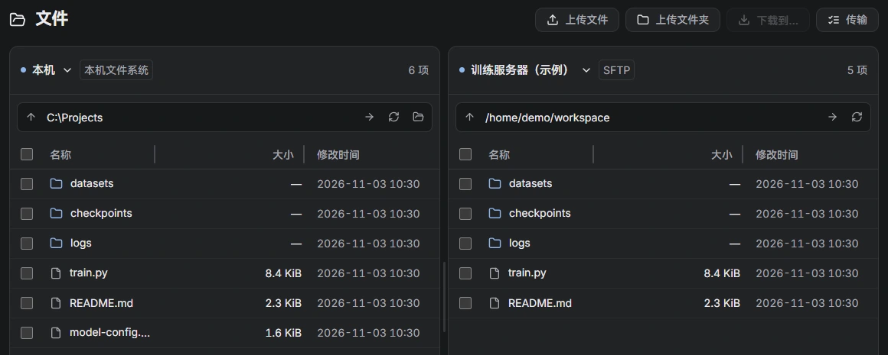

  

<h1 align="center">AsterHub</h1>

<strong>本机与服务器的资源监测工作台</strong>

  看实时负载、回查峰值、对比多张显卡。 
  通过 SSH 打开终端、浏览和传输文件。

  
  
  
  

   
  资源概览 · 演示设备与示例数据

## 主要功能

以下界面使用示例设备和数据。点击截图可查看原尺寸。

### 排查资源峰值

发现负载异常后，选定时间区间，对照 CPU 曲线和当时记录的进程占用。GPU、内存和网络也有各自的分析页，可分别回查显存、内存和流量变化。

  

### 对比多张显卡

同屏查看每张卡的利用率和显存，找出哪张卡最忙、哪张还有余量。温度和功耗等指标视设备和驱动支持而定。

  

### 定位磁盘空间占用

扫描磁盘或文件夹，按面积看各目录占了多少空间。点击目录逐层查看，也可以切到大文件清理，直接定位占空间的文件。

  

### 管理远端设备和文件

连上服务器后，可以打开 SSH 终端执行命令，也可以在双栏文件页里并排浏览本机和远端目录，拖拽文件进行复制。

  

### 日常监测与任务

- **任务栏监测**：把 CPU、GPU、内存或网速放在任务栏，按自己的习惯调整指标、顺序和颜色。

- **网络测速**：随时测一次连接速度，也可以到流量分析查看指定时段的上传和下载。

- **任务中心**：集中查看更新下载、文件传输和磁盘扫描的进度与结果。

## 下载安装

1. 打开 [最新发行版](https://github.com/1159112519/AsterHub/releases/latest)，在 **Assets** 下载 `AsterHub-Setup-*.exe` 并运行。
2. 打开 AsterHub 后，选左侧「本机」开始监测；要添加服务器，在「我的设备」旁点 `+`，填写 SSH 连接信息。

**系统要求：** Windows 10 1809 或更新版本（64 位）、.NET Framework 4.7.2 或更新版本。安装器会检查 Microsoft Edge WebView2 Runtime。

**已经安装？** 打开「关于 AsterHub」检查更新，下载完成后点击「安装并重启」。各版本的改进见[更新记录](CHANGELOG.md)。

## 开发与许可

构建方法见[开发指南](docs/BUILDING.md)，第三方组件及其许可见[第三方组件说明](docs/THIRD-PARTY.md)。项目源码公开浏览，尚未授予通用开源许可。
